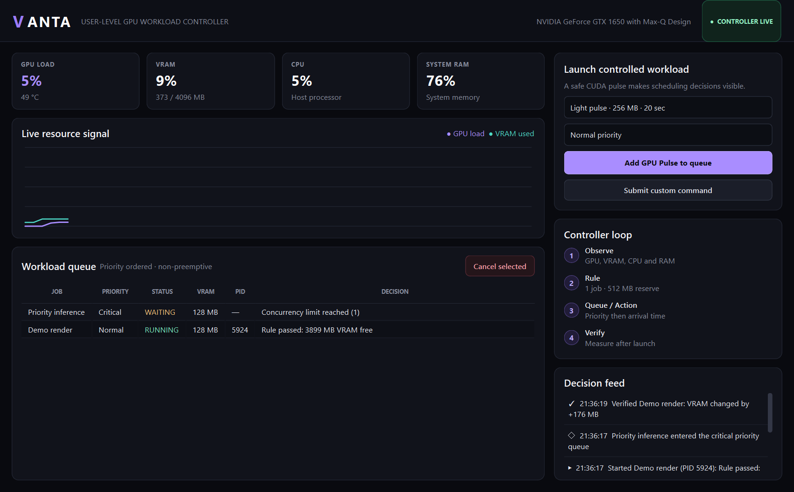

# VAnta

<p align="center">
  
</p>

## Native Microsoft Store candidate

The native Store edition (0.2.1) has a locally checked preview MSIX. It is not yet an installed or Microsoft-certified release. This edition has read-only service/startup inventory and disables system cache/standby mutations. The Python/portable feature descriptions below may differ.

Build with `scripts/build-native.ps1 -Store` (Rust 1.100+). See [native usage](docs/NATIVE_USAGE.md), [release evidence and remaining gates](docs/STORE_RELEASE.md), [listing draft](docs/STORE_LISTING.md), and [privacy policy](docs/PRIVACY.md). Real Partner Center identity, public publisher/privacy details, installed-package lifecycle testing and WACK remain required before submission.


VAnta also includes a **Memory Map** workspace for RAM diagnostics, process
mappings, validated JSON snapshots and confirmed manual memory maintenance.
Maintenance supports one-process working-set trim, system file-cache trim,
and advanced standby-list purge. System-wide actions require an elevated launch;
standby purge uses an undocumented native Windows interface. This is **not full
RAMMap parity**. See [Memory Map usage and limitations](docs/MEMORY_MAP_USAGE.md)
and [RAMMap investigation](docs/RAMMAP_RESEARCH.md).

VAnta now includes a **Task Manager** workspace alongside **GPU Workloads**.
Open the existing desktop shortcut, then select **Task Manager**. See
[Task Manager usage and limitations](docs/TASK_MANAGER_USAGE.md).


VAnta is a user-level GPU workload controller for Windows. It gives GPU jobs a
visible queue, an explainable VRAM admission rule, controlled process launch,
and post-launch verification.

The controller follows one loop:

**Observe → Rule → Queue / Action → Verify**

VAnta runs as a normal desktop application. The GPU controller does not modify
NVIDIA drivers or Windows scheduling. The Task Manager workspace can explicitly
change process priority/affinity, terminate selected processes, change startup
entries, and control services after confirmation, subject to Windows permissions.



## What it provides

- Live NVIDIA GPU, VRAM, temperature, power, CPU, and RAM telemetry
- Critical, high, normal, and low priority scheduling
- One controlled GPU workload at a time in the live MVP controller
- A 512 MB VRAM safety reserve and explainable admission decisions
- Controlled launch and cancellation of child processes
- Before/after VRAM verification and a decision feed
- SQLite job and event history restored across app restarts
- Safe recovery of interrupted child processes after an unexpected shutdown
- A Policy Lab comparing strict priority with fit-what-fits scheduling
- A one-click demo scenario for queueing, verification, and the VRAM guard
- A built-in CUDA pulse that does not require PyTorch or the CUDA Toolkit

## Quick start for users

1. Download the latest `VAnta-windows-x64.zip` from the [Releases](../../releases) page, extract it, and run `VAnta\VAnta.exe`.
2. Click **Run demo scenario**.
3. Watch the queue and **Decision feed**:
   - the balanced workload starts first;
   - the critical workload waits without interrupting it;
   - the VRAM guard check is rejected when it exceeds safe capacity.
4. Use **Add GPU Pulse to queue** for a light, balanced, or heavy workload.
5. Use **Submit custom command** for a CLI workload you want VAnta to start.
6. Select a job and click **Cancel selected** to stop a queued or running job.
7. Open **Policy Lab** to compare the two queue policies with a deterministic
   replay.

The built-in CUDA pulse requires a working NVIDIA driver and an NVIDIA GPU.
The dashboard can still open without one, but telemetry and CUDA pulse jobs
will be unavailable. VAnta does not install a driver or the CUDA Toolkit.

## Installation from source

### Requirements

- Windows 10 or Windows 11
- Python 3.11 or newer, or [uv](https://docs.astral.sh/uv/)
- An NVIDIA GPU and current NVIDIA driver for live GPU telemetry and the CUDA
  pulse

Install `uv` in PowerShell if it is not already installed:

```powershell
winget install --id=astral-sh.uv -e
```

Clone and run VAnta:

```powershell
git clone https://github.com/pllpert643-ship-it/VAnta.git
cd VAnta
uv sync --extra dev
uv run vanta
```

`uv sync` creates the project environment and installs the exact locked
dependencies from `uv.lock`. No global Python package installation is needed.

## Build the Windows application

Run PowerShell from the repository root:

```powershell
.\scripts\build.ps1
```

The script installs the locked dependencies, runs PyInstaller, and creates:

```text
dist\VAnta\VAnta.exe
```

The packaged application runs at normal user level. It does not install a
Windows service. To test the packaged executable without opening the full UI:

```powershell
.\dist\VAnta\VAnta.exe --help
```

## Verify a checkout

```powershell
uv run pytest -q
```

The test suite covers admission rules, scheduling order, process recovery,
persistence, the demo scenario, and the Policy Lab.

## Local data and logs

VAnta stores its local SQLite database and child-process logs under:

```text
%LOCALAPPDATA%\VAnta\
```

Deleting that directory resets local job and decision history. Running jobs
should be stopped from the app before removing it.

## Troubleshooting

**The header says `GPU telemetry unavailable`.** Check that an NVIDIA GPU and
driver are installed. VAnta uses NVML through `nvidia-ml-py`; the CUDA Toolkit
is not required.

**A CUDA pulse exits immediately.** Check the process log under
`%LOCALAPPDATA%\VAnta\logs\`. The pulse needs `nvcuda.dll`, which is provided by
the NVIDIA display driver.

**The queue says `QUEUE PAUSED`.** VAnta could not confirm that a workload from
an interrupted previous session stopped. Close or stop that process, then
restart VAnta so recovery can be checked again.

## Project documents

- [Project brief](docs/PROJECT.md)
- [Demo script](docs/DEMO_SCRIPT.md)
- [License](LICENSE)


## Rust native edition

The native migration is in `native/`, with its own Cargo lockfile, data directory and build output. It adds a resource timeline, process CSV export, motion preferences and an interactive Policy Lab. The Python edition and its data remain available during validation.

- [Native usage, migration scope and build instructions](docs/NATIVE_USAGE.md)
- [Native validation and local measurements](docs/NATIVE_VALIDATION.md)
- [Rust architecture and primary-source research](docs/RUST_RESEARCH.md)

Build with `./scripts/build-native.ps1`. The output is `dist/VAnta-Native/VAntaNative.exe` and `dist/VAnta-native-windows-x64.zip`. See the validation record before treating the native edition as feature-equivalent or production validated.
